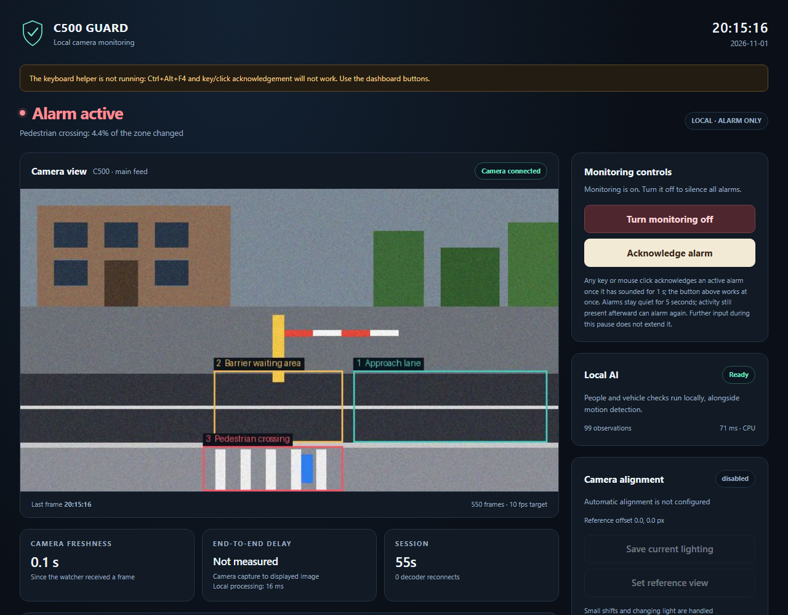
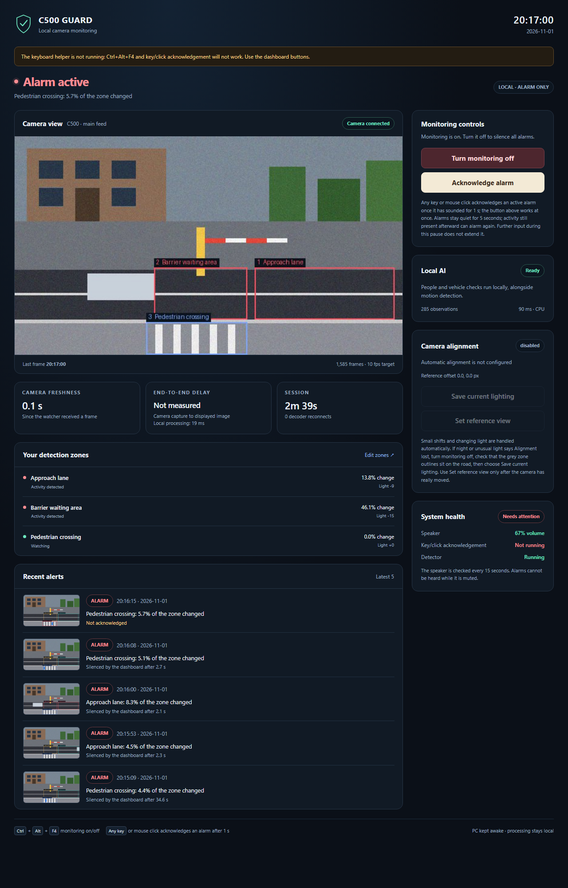

# C500 Guard - Local Camera Alarm for Gates and Barriers

Turn an ordinary home security camera into a proper alarm for a gate, barrier or car-park entrance.

C500 Guard watches the camera picture on your own PC. When a car, a person or anything else moves into an
area you've marked, it **sounds a siren that keeps going until someone acknowledges it**. You won't miss it
because it stopped on its own. If the camera freezes, goes black or drops off the network, it plays a
different warning tone, so a broken camera never looks like a quiet night.

One shortcut, **Ctrl + Alt + F4**, turns the whole system on or off from any window.





*Screenshots use a made-up demo scene: a generated video of a road, a barrier, a passing car and a
pedestrian. No real site or footage is shown.*

## Why it helps

- **You can't miss an alarm.** The siren only stops when a person presses a key, clicks, or uses the dashboard button.
- **Nobody can silence it too early.** Keys pressed in the first second don't count, so someone typing can't stop a new alarm before it's heard.
- **It warns you when something's wrong.** There's a separate tone for a lost, frozen or black camera feed, and a warning if the speaker is muted or too quiet.
- **Draw your own zones.** Mark the approach lane, the barrier and the footpath right on the live picture.
- **Spots people and vehicles.** A small AI model runs on your PC (no cloud, no account) and adds confirmed person and vehicle alerts.
- **Copes with night and small bumps.** Zones stay in place if the camera shifts slightly, and it learns how the scene looks at night.
- **Shows what happened.** Every alert keeps a picture from the moment it started and how it was silenced.
- **Runs by itself.** It starts when you sign in, restarts if it crashes, and keeps the PC awake while it's on.
- **Alarm only.** It never opens or moves a barrier, gate or any other equipment.

## Get started

You need a Windows PC on the same network as the camera, speakers, and Python 3.11+ (3.13 tested). It's
built for the **Xiaomi C500** camera, but any RTSP/ONVIF camera, USB webcam, screen area or video file works too.

```powershell
git clone https://github.com/Assembler-Fourier/c500-guard.git C:\c500-guard
cd C:\c500-guard
Set-ExecutionPolicy -Scope Process Bypass -Force
.\install.ps1
```

Then open **http://127.0.0.1:8787**. Full step-by-step setup: [docs/WINDOWS.md](docs/WINDOWS.md).
Daily use for the person on shift: [docs/CURRENT-SETUP.md](docs/CURRENT-SETUP.md).

| To... | Do this |
|---|---|
| Turn monitoring on or off | **Ctrl + Alt + F4**, the dashboard button, or `ctl.py on` / `off` |
| Silence a sounding alarm | Any key or mouse click (after 1 second), or **Acknowledge** |
| Check everything is working | `ctl.py doctor` |
| Test the siren | `ctl.py test-alarm` |

**Try it without a camera:** point it at any video file.

```powershell
.venv\Scripts\python.exe src\watch.py watch my-clip.mp4 --silent
```

macOS and Linux work too (`./install.sh`). There's no global hotkey there, so use the dashboard button
or `ctl.py toggle`.

## Good to know

- Motion detection can react to rain, animals or a screen in view. Draw zones carefully and test day and night.
- The Xiaomi route needs the camera on the same network **and** internet access for Xiaomi sign-in. A plain RTSP/ONVIF camera avoids both.
- It can't alert anyone if the PC loses power or the speaker is muted. Run `ctl.py test-alarm` before relying on it.

## Who it is for

Security guards and control rooms, car parks, gated sites, warehouses, farms, small businesses and homes:
anyone who wants a loud, local alarm from a camera without a monthly subscription.

**Keywords:** camera alarm, motion detection alarm, gate alarm, barrier camera, car park security, Xiaomi
C500, Xiaomi camera RTSP, go2rtc, local AI person detection, vehicle detection, YOLOX ONNX, home security
software, CCTV alarm, siren until acknowledged, Python security camera software, Windows.

---

## Technical details

**Pipeline.**

```
Xiaomi C500 --LAN--> go2rtc bridge --rtsp://127.0.0.1:8554/c500--> watcher --> siren
                                                                     |
                                     Ctrl+Alt+F4 / dashboard --------+  on / off / acknowledge
```

`bridge.py` handles Xiaomi cloud authentication and runs a locally built **go2rtc v1.9.14** with a narrow
command-queue fix (`patches/`, with build provenance and a Go regression test), re-publishing the camera as
local RTSP. `lan_shim.py` provides a TCP relay for networks where discovery fails.

**Detection.** `watch.py` decodes frames with FFmpeg into a latest-frame queue (640×360, ~10 fps target)
and runs two independent channels per zone: **motion** (percentage of pixels differing from a slowly
adapting background, with a configurable pixel threshold and on/off frame hysteresis) raising the main
siren, and **light** (mean-luminance jump) raising an early-warning chirp that escalates if motion
confirms. Feed health detects lost, frozen and black frames with grace periods, and a detector-loop
watchdog hands a stalled loop to the supervisor.

**Local object detection.** `object_detector.py` runs **YOLOX-Tiny (COCO, ONNX Runtime, CPU)** on a worker
for confirmed person, bicycle, car, motorcycle, bus and truck alerts, with a confidence threshold, automatic
retry and backoff after transient failures, and visible recovery state. AI only adds alerts. It never
vetoes motion alarms. Model provenance and licence: [docs/LOCAL-ML.md](docs/LOCAL-ML.md).

**Scene alignment.** `scene_alignment.py` uses **OpenCV ORB landmarks with RANSAC** homography to keep
zones attached to the scene through small camera shifts (bounded translation, rotation and scale). It has a
hold-last-verified-pose tier during brief landmark loss, a confirmation-only tier for weak night evidence
(never moves zones), and up to four learned lighting references that are validated over subsequent frames
before being kept.

**Alarm state machine.** Latched alarms with unique ids, so a stale acknowledgement can't silence a newer
alarm or one from a restarted watcher. A one-second input guard, a five-second quiet window after
acknowledgement, and re-evaluation at expiry without replaying cleared events.

**Windows integration.** `hotkey_win.py` uses `RegisterHotKey` plus low-level keyboard and mouse hooks
(ignoring injected input and never recording typed text or pointer positions) on separate threads from
network calls. `platform_support.py` abstracts audio (Core Audio volume and mute checks), sleep inhibition,
process identity and capture syntax across Windows, macOS and Linux. `service.py` supervises the processes,
and `install.ps1` registers per-user scheduled tasks.

**Dashboard.** A dependency-free local web UI (`dashboard_ui.py`) on `127.0.0.1` only, with
origin and control-header checks on every state-changing request. It has a live preview, per-zone metrics,
a zone editor that draws on the live frame (with backup on save), system health and an alert history with
snapshots.

**Tests.** 16 `unittest` modules covering acknowledgement, alignment, background processes, the dashboard
(with a Node harness), health, the hotkey ABI, illumination, the LAN shim, the object detector, process
identity, scene alignment, the semantic monitor, startup, supervisor recovery, the watcher and the zone editor:

```bash
python -m unittest discover -s tests
```

**Layout**

```
src/        watch.py bridge.py ctl.py service.py hotkey_win.py dashboard_ui.py zone_editor.py
            object_detector.py semantic_monitor.py scene_alignment.py illumination.py lan_shim.py platform_support.py
config/     zones.example.json
models/     model manifest + YOLOX licence (weights downloaded and verified at install)
patches/    go2rtc fix, build manifest, provenance
docs/       WINDOWS.md CURRENT-SETUP.md LOCAL-ML.md RUNBOOK.html runbook PDF, audit notes, screenshots
tests/      unit and integration tests
```

## Licence

MIT. See [LICENSE](LICENSE). go2rtc is MIT-licensed; YOLOX licence in `models/YOLOX-LICENSE.txt`.
